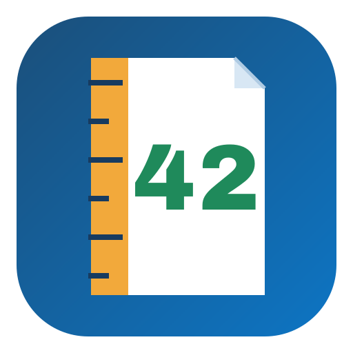

<p align="center">
  
</p>

# TruePageCalibre

[](https://github.com/oatlayers/TruePageCalibre/actions/workflows/tests.yml)
[](https://github.com/oatlayers/TruePageCalibre/releases/latest)
[](LICENSE)

A standalone Calibre plugin that stores page counts in an integer custom
column. It is designed for mixed language libraries where a single
"characters per page" value is not good enough.

## Requirements

- Calibre 6.0 or later.
- An integer custom column for the page counts (default: `#pages`). The plugin
  refuses other column types.
- No separate Python installation is needed to use the plugin.

## Quick start

1. Download `TruePageCalibre.zip` from the latest release, or build it from
   source (see [Installation](#installation)).
2. In Calibre, open **Preferences → Plugins → Load plugin from file**, select
   the ZIP and restart Calibre.
3. Add the **Count pages** action to the toolbar, then choose
   **Count pages for all books** once.

See [Installation](#installation) for the full instructions.

## What it does

For each selected book:

1. **PDF** — uses the real PDF page count.
2. **Fixed-layout EPUB** — one page per spine item.
3. **EPUB with embedded print pagination** — uses, in order:
   - the EPUB 3 nav `page-list`,
   - the EPUB 2 NCX `pageList`/`pageMap`,
   - an Adobe `page-map.xml`,
   - page-numbered pagebreak markers.

   The **highest** page number is used, because the page numbers belong to
   the printed book. Roman-numbered front matter is added when it is clearly
   separate from the arabic body (for example pages i-xviii + 1-300 gives
   318 pages). This can be turned off in the configuration.

   A short or partial page list is not trusted; the estimate is used instead.
4. **EPUB without embedded pagination** — estimates from the visible text
   using a language-aware, script-aware model. Korean, Chinese/Japanese and
   Latin text are counted separately, so English quotations inside a Korean
   book do not use the Korean characters-per-page value.
5. **Other formats** — falls back to Calibre's built-in page counter.

## Why this differs from the Count Pages plugin

The well-known Count Pages plugin estimates pages with one of several
algorithms (APNX accurate, Calibre viewer, Adobe Digital Editions, or a
custom characters-per-page value). Those algorithms are useful, but they
ignore the pagination the publisher already embedded in many EPUBs.

This plugin uses the publisher's pagination whenever it exists, and only
falls back to an estimate when it does not. The estimate is also calibrated
from the library itself: books with real embedded pagination teach the
plugin how many characters this library's books actually hold per page.

## How the estimate is calibrated

A single characters-per-page value cannot fit a whole library.

After a count, the plugin collects books whose page count came from real
embedded pagination and fits a model per language:

- **30 or more samples** — a length-aware power law
  `characters_per_page = a * characters^b`. Longer books are usually set
  more densely, so a 600,000-character book needs more characters per page
  than a 100,000-character book.
- **8 to 29 samples** — a robust median characters-per-page value.
- **fewer than 8 samples** — the configured characters-per-page value is
  used unchanged.

The fitted values are stored in the plugin configuration and reused for
later runs. A small "count selected" run will not replace a model fitted
from the whole library.

Default fallbacks are:

- Korean: 300
- Chinese/Japanese: 700
- English: 1500
- Other: 1500

These are only fallbacks. The first "Count pages for all books" run will
learn the values for your library.

## Measured accuracy

On the 1,049-book reference library:

| Method | Median error | 90th percentile error |
|---|---|---|
| Fixed 1500 characters/page (English) | ~19% | ~43% |
| Calibrated estimate (English) | ~11% | ~32% |
| Fixed 390 characters/page (old Korean default) | ~24% | ~29% |
| Calibrated estimate (Korean) | ~7% | ~40% |

The calibration model is fitted from 225 English books and 10 Korean books
with real embedded pagination in the reference library. A separate holdout
of 47 English books that only had pagebreak markers went from 21.3% median
error (fixed value) to 14.2% with the calibrated model. The 90th percentile
for Korean is dominated by two literary novels whose print editions are much
denser than the rest.

Embedded pagination is exact by definition; no estimate is applied to those
books. The biggest single improvement was Adobe `page-map.xml`: 57 books in
the reference library contain one, including 10 Korean books, and Calibre's
own TOC parser does not read them. Books that had only a page map were
previously estimated up to 88% too long (for example 874 pages instead of 474
= 466 arabic pages plus 8 roman front-matter pages; a Korean novel went from
251 to 332 pages).

Page counts can still differ from a paper edition because the EPUB may be
based on a different printing. No text-only method can know the trim size,
font size and leading of every printed edition.

## How the embedded pagination is used

The page numbers in an EPUB page list are the page numbers of the printed
book, so the **highest** page number is used rather than the number of
entries. A list that only marks every tenth page still says how long the
book is, while a list with one entry per page gives the same answer.

An embedded count is only trusted when it is at least a fifth of the
estimated page count (and at least *Minimum embedded pagination entries*).
Without that check a book with a short, partial page list would be reported
as a 12-page book instead of a 300-page one. When the embedded pagination is
not trusted the calibrated text estimate is used instead.

## Installation

1. Clone the repository and build the plugin ZIP (or download a release ZIP
   when one is available):
   ```powershell
   git clone https://github.com/oatlayers/TruePageCalibre.git
   cd TruePageCalibre
   python build_plugin.py
   ```
   This produces `dist/TruePageCalibre.zip`. The ZIP must contain
   `plugin-import-name-accurate_page_count.txt`; that file is what makes
   `calibre_plugins.accurate_page_count` importable. The ZIP is a build
   artifact and is not tracked by git.
2. In Calibre: **Preferences → Plugins → Load plugin from file**.
3. Select the ZIP and restart Calibre.
4. Add the **Count pages** action to the toolbar, or use
   **Preferences → Toolbars & menus**.
5. Right-click the action for:
   - Count pages for selected books
   - Count pages for all books
   - Configure TruePageCalibre

The default target column is `#pages`. You can choose any integer custom
column in the configuration dialog. To upgrade, load the new ZIP and restart
Calibre; the configuration and stored calibration are kept. The internal
plugin import name and settings path remain `accurate_page_count` for
compatibility with existing installations.

## Recommended workflow

- Run **Count pages for all books** once. This uses the books with embedded
  pagination to calibrate the estimate for the rest.
- After that, **Count pages for selected books** for new books; the stored
  calibration is reused.
- The completion dialog reports how many counts came from each source and
  what the calibration learned.
- Re-run the count after changing the characters-per-page settings or
  clearing the calibration.

## Accuracy notes

- A reflowable EPUB has no intrinsic page count. "Accurate" here means the
  print pagination embedded by the publisher when available, or a calibrated
  estimate otherwise.
- KOReader's screen pages depend on font size, margins, line spacing, and
  screen size. No Calibre-side count can match KOReader exactly; this plugin
  targets print-equivalent pages.
- If an EPUB has no pagination and no reliable text layer (for example a
  scanned image comic), the plugin uses one page per image in image-only
  books. PDF page counts are always exact.
- The calibration is only as good as the library's embedded pagination. A
  library with no page lists or page maps falls back to the configured
  characters-per-page values.

## Source layout

- `plugin/` — Calibre plugin payload; these files form the ZIP root
  - `core.py` — counting logic (no Qt imports)
  - `worker.py` — Calibre background job entry point
  - `action.py` — toolbar/menu action and column updates
  - `config.py` — settings dialog
  - `images/page.png` — 128 px toolbar icon exported from the logo
  - `plugin-import-name-accurate_page_count.txt` — Calibre plugin marker
    (legacy name kept for compatibility)
- `assets/logo.svg` — master logo and icon artwork
- `assets/logo.png` — 512 px export for documentation and listings
- `tests/` — pure and Calibre-backed tests
- `tests/epub_fixtures.py` — generates the EPUB files used by the Calibre tests
- `build_plugin.py` — builds `dist/TruePageCalibre.zip`
- `run_tests.py` — test runner for plain Python or `calibre-debug`
- `.github/workflows/tests.yml` — CI: unit tests and plugin build
- `CONTRIBUTING.md` — development and pull request guidelines
- `CHANGELOG.md` — release history
- `LICENSE` — MIT license

## Development

Run the pure unit tests with any Python 3:

```powershell
python -m unittest discover -s tests -v
```

`python run_tests.py` runs the same suite. Tests that need Calibre are skipped
automatically when Calibre cannot be imported. To run them too, use the Python
that ships with Calibre:

```powershell
& "C:\Program Files\Calibre2\calibre-debug.exe" -e run_tests.py
```

On macOS and Linux, use the `calibre-debug` binary from the Calibre
installation:

```sh
calibre-debug -e run_tests.py
```

The counting engine can also be exercised directly with Calibre's Python by
adding `plugin/` to `sys.path` and importing `core` to call `count_epub()` /
`count_pdf()`.

The GitHub Actions workflow runs the pure tests on Python 3.10-3.14 and builds
the plugin ZIP to check that the package is complete.

## Contributing

Bug reports and pull requests are welcome. See
[CONTRIBUTING.md](CONTRIBUTING.md) for development setup, test commands and code
guidelines.

## License

This project is licensed under the MIT License. See [LICENSE](LICENSE).
